# CalculatriceWS – Service Web SOAP avec Jakarta XML Web Services

> TP2 – Architecture SOA et services web | LSI3-GLSI
> Faculté des Sciences de Sfax | Année universitaire 2025-2026
> **Réalisé par : Hana BEN HMAD**

---

## 1. Description

**CalculatriceWS** est une application Java qui expose un service web **SOAP** de calculatrice. Elle propose quatre opérations : somme, soustraction, multiplication et division.

Le service est développé avec **Jakarta XML Web Services (JAX-WS)**, géré par **Maven**, publié avec `Endpoint.publish` et testé avec **SoapUI**.

## 2. Technologies utilisées

| Outil | Version |
|---|---|
| Java (JDK) | 17+ (testé avec JDK 25) |
| Maven | 3.9+ |
| jakarta.xml.ws-api | 2.3.3 |
| jakarta.jws-api | 2.1.0 |
| jaxws-rt (implémentation) | 2.3.5 |
| IntelliJ IDEA | 2024+ |
| SoapUI | 5.10.0 |

## 3. Structure du projet

```
CalculatriceWS
├── pom.xml
├── README.md
├── docs/captures/                # Captures d'écran du TP
└── src/main/java
    ├── service
    │   ├── ICalculatrice.java    # Contrat du service (interface annotée)
    │   └── Calculatrice.java     # Implémentation métier
    └── serveur
        └── ServeurJWS.java       # Publication du service (Endpoint)
```

## 4. Opérations exposées

| Opération | Paramètres | Résultat |
|---|---|---|
| `somme` | `a`, `b` (double) | a + b |
| `soustraction` | `a`, `b` (double) | a - b |
| `multiplication` | `a`, `b` (double) | a × b |
| `division` | `a`, `b` (double) | a / b (SOAP Fault si b = 0) |

## 5. Installation et exécution

**Prérequis** : JDK 17 ou plus, Maven, port **9090** libre.

```bash
git clone https://github.com/TON-USER-GITHUB/CalculatriceWS.git
cd CalculatriceWS
mvn clean compile exec:java
```

Ou exécuter la classe `serveur.ServeurJWS` depuis IntelliJ IDEA.

Une fois le serveur démarré :

| Ressource | URL |
|---|---|
| Service | http://localhost:9090/calculatrice |
| WSDL | http://localhost:9090/calculatrice?wsdl |
| XSD | http://localhost:9090/calculatrice?xsd=1 |

## 6. Annotations Jakarta XML Web Services

| Annotation | Rôle |
|---|---|
| `@WebService` | Déclare l'interface et la classe comme service web |
| `@WebMethod` | Expose une méthode comme opération SOAP |
| `@WebParam` | Nomme les paramètres dans le contrat WSDL/XSD |
| `@WebResult` | Nomme l'élément de retour |

## 7. Correspondance classe Java ↔ WSDL / XSD

| Code Java | WSDL / XSD |
|---|---|
| `ICalculatrice` | `<portType name="ICalculatrice">` |
| `serviceName = "CalculatriceWS"` | `<service name="CalculatriceWS">` |
| `@WebMethod(operationName="somme")` | `<operation name="somme">` |
| `@WebParam(name="a")`, `(name="b")` | éléments `a` et `b` de type `xs:double` |
| `@WebResult(name="resultat")` | élément `resultat` dans `sommeResponse` |
| `targetNamespace = "http://service/"` | `targetNamespace="http://service/"` |

## 8. Test avec SoapUI

1. **File > New SOAP Project**
2. Initial WSDL : `http://localhost:9090/calculatrice?wsdl`
3. Ouvrir l'opération voulue > **Request 1**
4. Remplacer les `?` par les valeurs de `a` et `b`, puis cliquer sur ▶

Exemple de requête :

```xml
<soapenv:Envelope xmlns:soapenv="http://schemas.xmlsoap.org/soap/envelope/" xmlns:ser="http://service/">
    <soapenv:Header/>
    <soapenv:Body>
        <ser:somme>
            <a>10</a>
            <b>5</b>
        </ser:somme>
    </soapenv:Body>
</soapenv:Envelope>
```

Réponse :

```xml
<ns2:sommeResponse xmlns:ns2="http://service/">
    <resultat>15.0</resultat>
</ns2:sommeResponse>
```

## 9. Résultats des tests

| Opération | a | b | Résultat obtenu |
|---|---|---|---|
| somme | 10 | 5 | 15.0 |
| soustraction | 10 | 5 | 5.0 |
| multiplication | 10 | 5 | 50.0 |
| division | 10 | 5 | 2.0 |
| division | 10 | 0 | SOAP Fault : « Division par zéro impossible » |

## 10. Captures d'écran

### Activité 1 : Projet Maven

**Structure du projet**

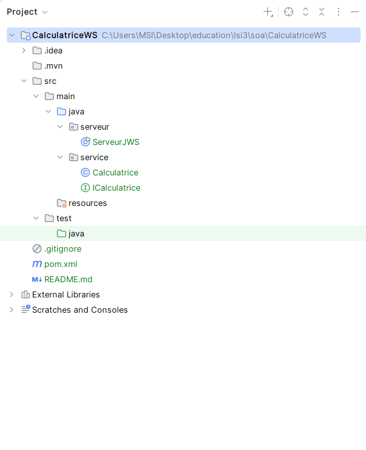

**Fichier pom.xml**

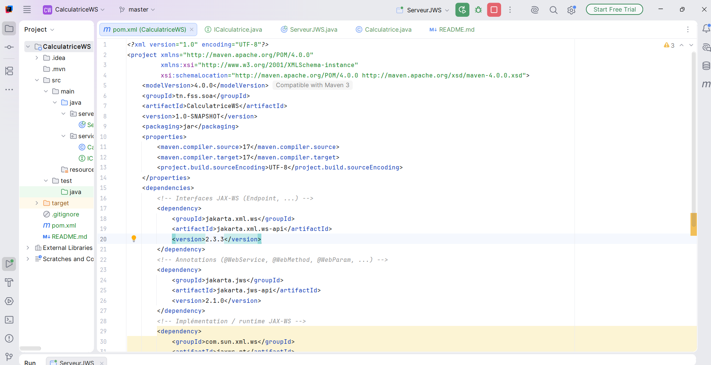

**Dépendances Maven chargées**

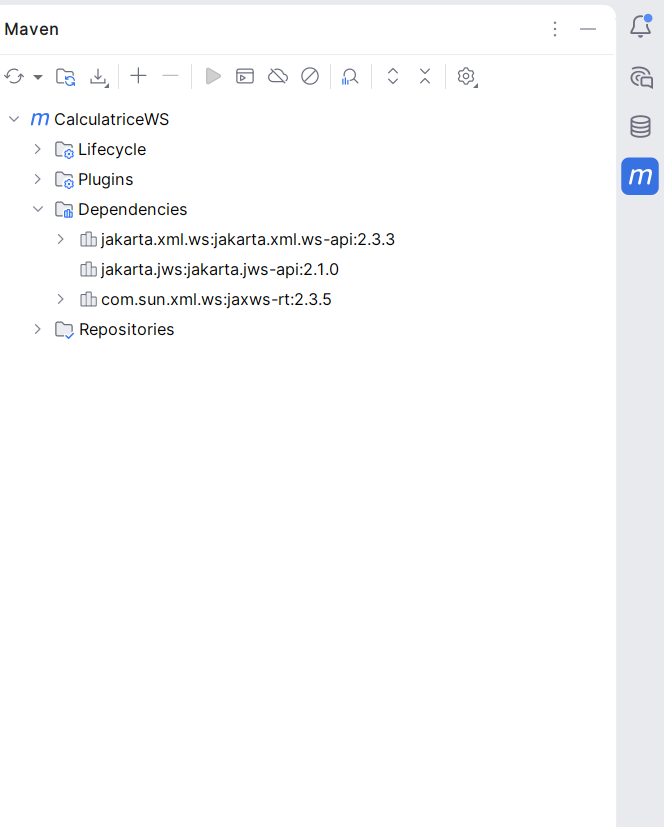

### Activités 2 et 3 : Interface, classe métier et annotations

**Interface `ICalculatrice`**

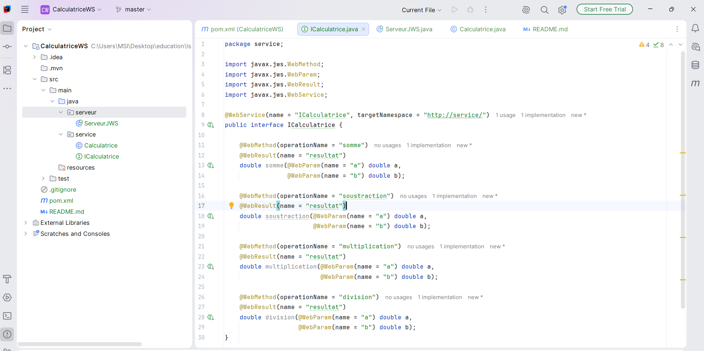

**Classe `Calculatrice`**

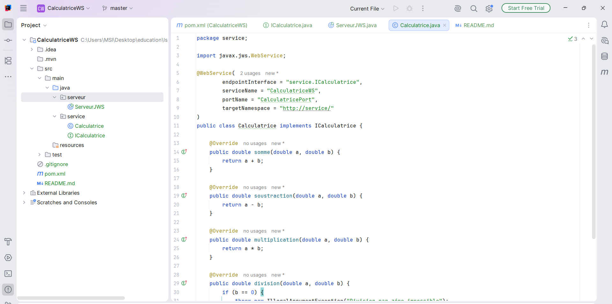

### Activité 4 : Publication du service

**Classe `ServeurJWS`**

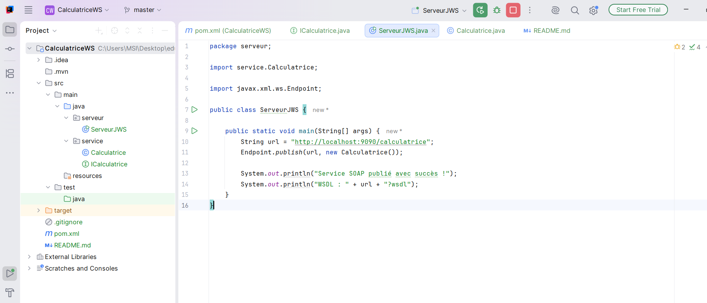

**Console du serveur**

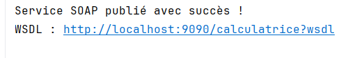

**WSDL généré**

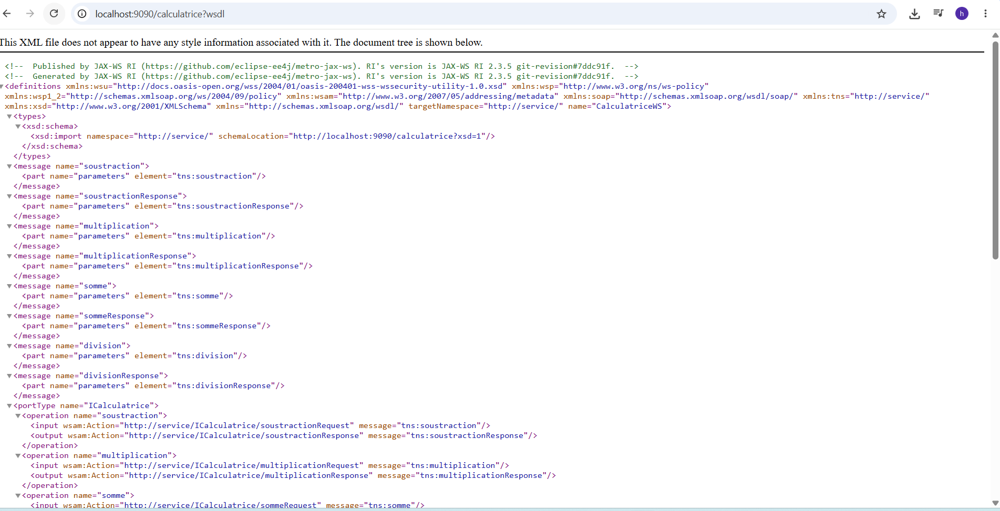

**XSD généré**

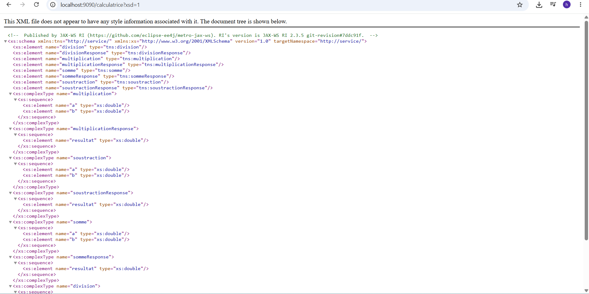

### Activité 5 : Tests avec SoapUI

**Création du projet SoapUI**

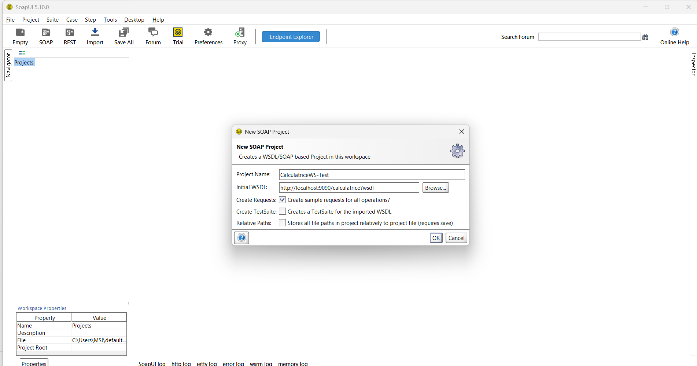

**Opérations importées**

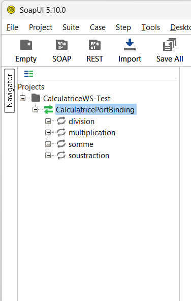

**Opération `somme`**

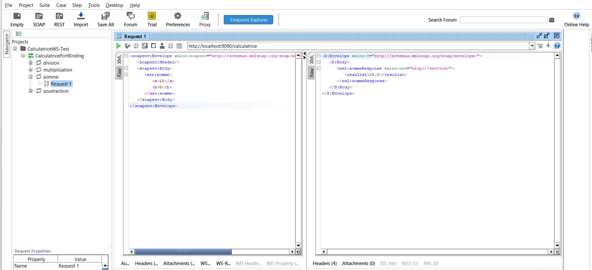

**Opération `soustraction`**

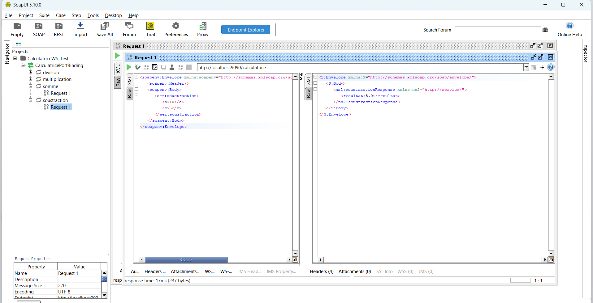

**Opération `multiplication`**

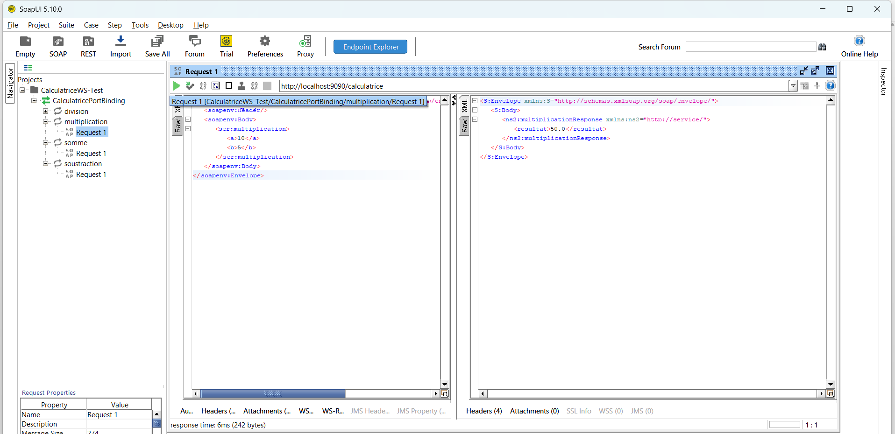

**Opération `division`**

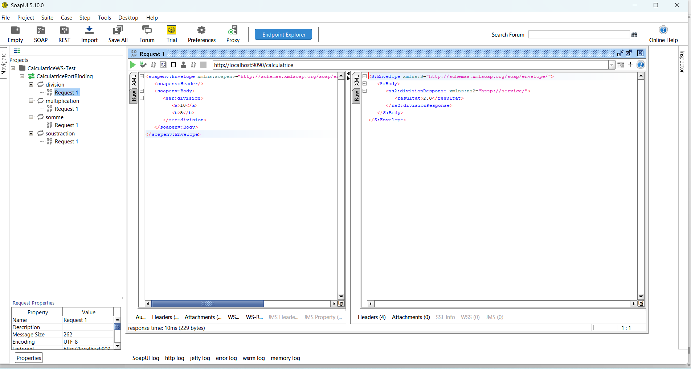

**Division par zéro (SOAP Fault)**

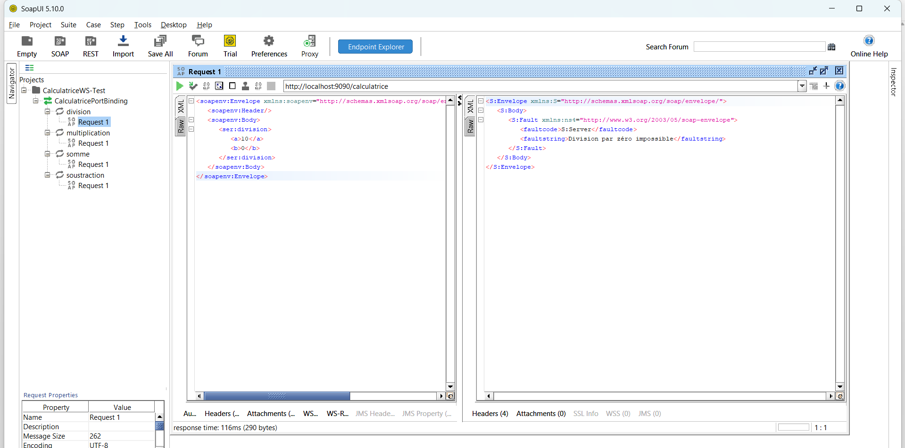

## 11. Problèmes courants

| Problème | Solution |
|---|---|
| `Address already in use` | Port occupé : changer le port dans `ServeurJWS` |
| `ClassNotFoundException` JAX-WS | Maven > Sync Project |
| Erreur `javax` / `jakarta` | Ne pas mélanger API 2.3.x (`javax`) et 3.x+ (`jakarta`) |
| Warnings `sun.misc.Unsafe` (JDK 24+) | Sans gravité, à ignorer |

## 12. Auteur

**Hana BEN HMAD** – LSI3-GLSI – Faculté des Sciences de Sfax – 2025-2026    